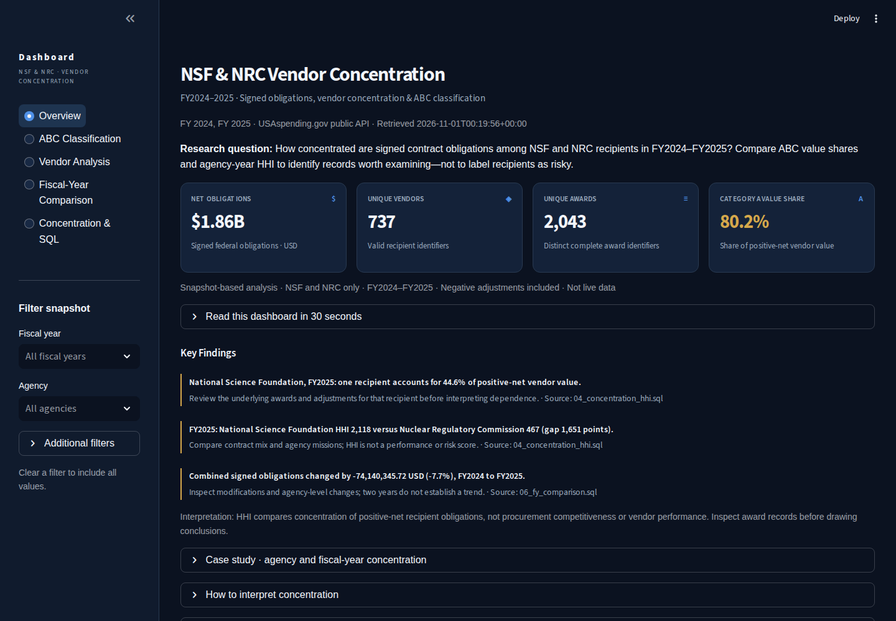
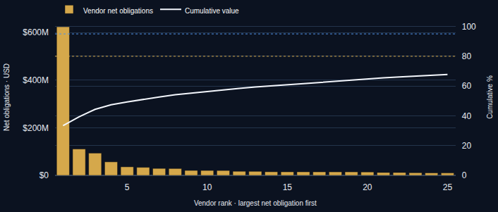
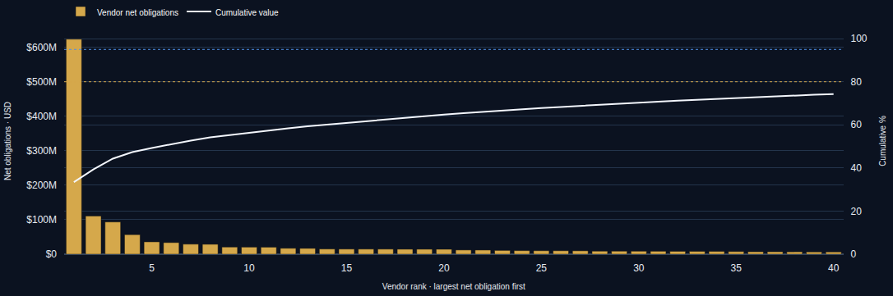
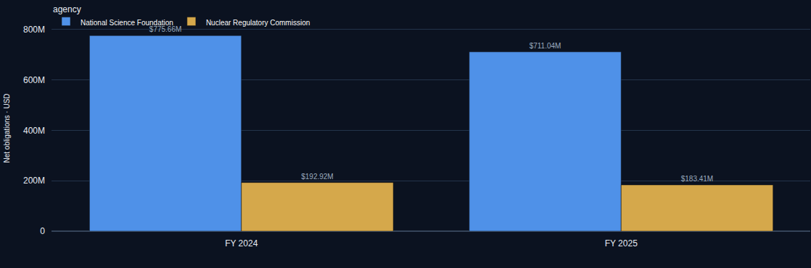

# Analisis Konsentrasi Vendor Kontrak Federal AS

Dashboard untuk menganalisis distribusi nilai kontrak pemerintah Amerika Serikat pada **National Science Foundation (NSF)** dan **Nuclear Regulatory Commission (NRC)** selama tahun fiskal **2024–2025**. Metode yang digunakan adalah **ABC/Pareto**, **Herfindahl–Hirschman Index (HHI)** dan perbandingan antartahun.

**[Lihat dashboard](https://usa-procurement-vendor-dashboard-candy.streamlit.app/)** · [Sumber data](docs/SOURCES.md) · [Metodologi](docs/METHODOLOGY.md)

**Teknologi:** Python, pandas, DuckDB SQL, Streamlit, Plotly.

## Temuan utama

Dataset resmi USAspending.gov berisi **5.020 transaksi**, **2.043 award** dan **737 vendor teridentifikasi**. Snapshot diambil pada **1 November 2026 (UTC)**. Hasil berikut hanya berlaku untuk NSF dan NRC FY2024–2025, bukan seluruh pengadaan federal AS.

| Temuan | Hasil |
| --- | --- |
| Vendor terbesar NSF pada FY2025 | 44,6% dari nilai bersih positif vendor NSF |
| HHI FY2025 | NSF: 2.118; NRC: 467 |
| Perubahan nilai kewajiban kontrak bersih FY2024–FY2025 | Turun USD 74.140.345,72 (7,7%) |
| ABC gabungan | 60 dari 737 vendor (8,1%) di kategori A, mencakup 80,2% nilai bersih positif vendor |

HHI lebih tinggi menunjukkan nilai kontrak lebih terkonsentrasi **dalam cakupan analisis ini**. Metrik tersebut tidak mengukur kualitas vendor atau membuktikan risiko pengadaan.

## Makna temuan dan tindak lanjut

**Temuan:** Dalam cakupan NSF dan NRC FY2024–2025, 60 vendor kategori A (8,1% dari vendor teridentifikasi) mencakup 80,2% nilai bersih positif vendor. HHI FY2025 juga berbeda antara NSF dan NRC.

**Tindak lanjut yang disarankan:** Prioritaskan penelaahan konsentrasi pada vendor dengan kontribusi nilai terbesar per instansi dan tahun fiskal. Gunakan tabel vendor dan perbandingan tahunan untuk melihat komposisi nilainya sebelum menentukan apakah pemeriksaan tambahan diperlukan.

**Batas interpretasi:** Ini prioritas analisis berdasarkan konsentrasi nilai, bukan bukti risiko, penyimpangan, atau penilaian kualitas vendor.

## Tampilan dashboard



| Analisis Pareto | Distribusi ABC |
| --- | --- |
|  |  |



## Fitur

- **Overview:** KPI, temuan utama, Pareto dan konsentrasi kontrak.
- **ABC Classification:** klasifikasi vendor berdasarkan kontribusi nilai.
- **Vendor Analysis:** rincian dan peringkat vendor menggunakan identitas UEI.
- **Fiscal-Year Comparison:** perbandingan FY2024 dan FY2025.
- **Concentration & SQL:** HHI serta hasil analisis SQL.

Filter tahun fiskal, instansi, negara bagian penerima, dan jenis kontrak diterapkan sebelum perhitungan. Tersedia unduhan transaksi terfilter dan ringkasan vendor.

## Data dan metode

Sumber: [USAspending.gov](https://www.usaspending.gov/) melalui [API resminya](https://api.usaspending.gov/). Tanggal transaksi **1 Oktober 2023–30 September 2025**. Data bersifat historis dan tidak diperbarui otomatis.

Satu baris merepresentasikan transaksi atau perubahan kontrak, bukan satu kontrak utuh. Nilai negatif dipertahankan sebagai penyesuaian kewajiban. Vendor diidentifikasi berdasarkan **Unique Entity Identifier (UEI)**.

Tahapan analisis:
1. Memeriksa cakupan, tanggal, nilai, identitas dan duplikasi transaksi.
2. Menghitung kewajiban bersih menggunakan transaksi positif maupun negatif.
3. Mengelompokkan vendor berdasarkan kontribusi nilai bersih positif melalui ABC.
4. Menghitung HHI dan kontribusi vendor terbesar per instansi serta tahun fiskal.
5. Membandingkan FY2024–FY2025 dan menguji konsistensi pandas dengan SQL.

Dataset terolah dan catatan kualitas tersedia di `data/processed/`. Definisi kolom dan rumus dijelaskan pada [kamus data](docs/DATA_DICTIONARY.md), [metodologi](docs/METHODOLOGY.md) dan [validasi](docs/validation.md).

### Batasan

- Dua instansi dan dua tahun fiskal tidak mewakili keseluruhan pengadaan federal AS.
- *Contract obligations* adalah komitmen anggaran, bukan pembayaran tunai.
- ABC dan HHI menggambarkan konsentrasi nilai, bukan performa vendor.
- Data historis USAspending dapat direvisi setelah snapshot diambil.

## Menjalankan secara lokal

Gunakan Python 3.12.

```bash
python -m venv .venv
python -m pip install -r requirements.txt
python -m streamlit run app.py
```

Aplikasi memakai snapshot yang disertakan dalam repository sehingga tidak membutuhkan API key saat dibuka. Query berada di folder [`sql/`](sql/), sementara pengujian tersedia di [`tests/`](tests/).

## Pengembang

**Candy** · [GitHub](https://github.com/Granbe1l)

Sumber data: USAspending.gov.
